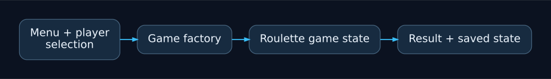

# Roulette C++ source archive

A historical Windows C++ roulette-style project built around players, game
creation and saved game state. The original commit history credits **Jacek
Gajek / Jacek**. Documentation maintenance does not transfer authorship of the
original source.

## Project overview

A historical Windows C++ roulette-style project with the original code authors retained.

Source-history attribution: Jacek Gajek / Jacek. This diagram does not establish a new license or transfer authorship.

## Build context

Open `Ruletka.sln` in a compatible Visual Studio installation with the C++
desktop workload. The tracked project selects the original Windows/MSVC
toolchain; an automatic modern Windows build has not been verified.

## Source layout

- `Ruletka/main.cpp`, `MainMenu.*`: entry point and menu.
- `GameFactory.*`, `Game.*`: game creation and shared game state.
- `Player.*`, `Human.*`, `Bot.*`: player roles.
- `Number.*`, `Color.*`, `Choice.*`: game choices.
- `Casino.*`, `save.txt`: persisted state and supporting logic.

## Attribution and reuse

Preserve the existing author names and history. No license grant for the
original source is added by this README.
